# معماری فعلی Hotel GDS

آخرین بازبینی: 2026-10-17  
Branch مبنا: `snapptrip`  
کد مبنای بررسی قبل از اضافه شدن این مستند: `172ae8744c3930f9a3bb7228772b33d94fa6d9db`

> این سند باید همراه با کد فعلی خوانده شود. فایل‌های قدیمی داخل `docs/checkpoints` تاریخچه تصمیم‌ها هستند و ممکن است وضعیت امروز را کامل منعکس نکنند. برای مثال، معماری فعلی نرخ‌گیری از `hotel_provider_refresh_states` استفاده می‌کند، در حالی که بعضی checkpointهای قدیمی قبل از اضافه شدن این state نوشته شده‌اند.

## هدف سند

این فایل نقشه فنی سیستم Hotel GDS است تا برنامه‌نویس بعدی بداند:

- مسئولیت Hotel Core چیست؛
- مسئولیت هر Provider Module چیست؛
- نرخ و ظرفیت چگونه از Shared SSP تا `room_calendars` حرکت می‌کند؛
- `GRS` و `SnappTrip` چگونه مستقل از هم اجرا می‌شوند؛
- رزرو، خرید آنلاین/آفلاین، صف‌ها و cancellation در چه نقطه‌ای قرار دارند؛
- چه قواعد معماری نباید در توسعه‌های بعدی شکسته شوند.

---

# 1. قواعد معماری غیرقابل نقض

1. **Hotel Core منبع رفتار عمومی سیستم است؛ منطق Provider-specific نباید داخل Core پخش شود.**
2. **`providers.is_active` سوییچ عملیات خروجی Provider است.** اگر false باشد هیچ API call جدیدی نباید برای آن Provider انجام شود.
3. **`providers.is_online` فقط procurement mode را مشخص می‌کند.** نباید catalog، availability، cancellation، balance یا پاسخ محلی GDS را خاموش کند.
4. **خاموش بودن یک یا همه Providerها نباید API محلی Hotel GDS را از پاسخ‌دادن بیندازد.** داده موجود در DB همچنان قابل پاسخ است.
5. **Shared SSP زمان due شدن Hotel را تعیین می‌کند؛ هر Provider اجرای مستقل خودش را دارد.**
6. **Providerها مستقل dispatch می‌شوند و quota مستقل دارند.** خطا یا کندی یک Provider نباید Provider دیگر را متوقف کند.
7. **Shared schedule فقط وقتی جلو می‌رود که تمام stateهای مرتبط همان cycle terminal شده باشند.**
8. **قبل از هر outbound rate/availability request، mapping باید معتبر باشد.** نبودن map، map غیرفعال یا `provider_property_id` خالی یعنی درخواست خارجی نباید ارسال شود.
9. **`room_calendars` داده canonical نرخ و ظرفیت محلی است.** Search/Availability نباید برای هر درخواست کاربر مجبور به تماس با Provider باشد.
10. **Provider response باید داخل Provider Module normalize شود.** تفاوت currency، field naming، window limits و API contract نباید به Core نشت کند.
11. **عدم وجود نرخ یا `provider_empty` خطای سیستم نیست.** این حالت نباید alert پرسر و صدا تولید کند.
12. **رزرو محلی و تاریخچه داده Provider با غیرفعال شدن Provider حذف یا invalid نمی‌شود.**

---

# 2. نمای کلی سیستم

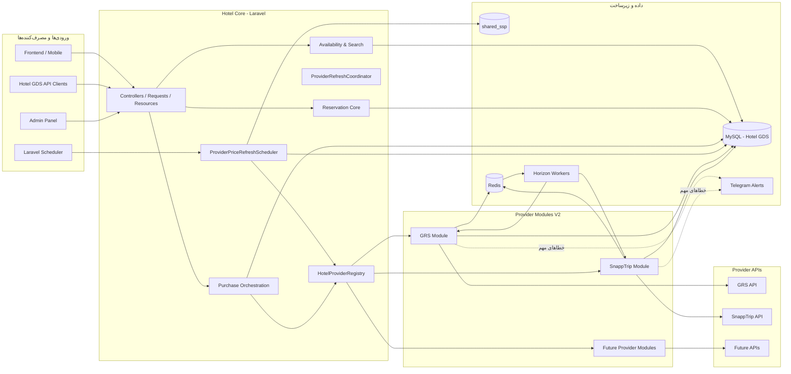

## مسئولیت Core

Core باید Provider-neutral باقی بماند. مهم‌ترین بخش‌های فعلی:

- `HotelProviderRegistry`
- `ProviderPriceRefreshScheduler`
- `ProviderRefreshCoordinator`
- `HotelPriceRefreshScheduleRepository`
- `HotelProviderRefreshStateRepository`
- Reservation services
- Purchase resolver/orchestration
- repositories مربوط به mapping و `room_calendars`

## مسئولیت Provider Module

هر Provider باید این موارد را خودش نگه دارد:

- authentication و HTTP client؛
- rate limit و provider-specific retry behavior؛
- mapping response به مدل canonical؛
- Jobها و Queueهای مخصوص Provider؛
- محدودیت‌های API مثل calendar window؛
- online booking implementation اگر پشتیبانی شود؛
- cancellation implementation اگر پشتیبانی شود؛
- currency conversion در boundary خود Provider.

---

# 3. Provider Registry و Extension Points

`HotelProviderRegistry` در وضعیت فعلی چهار نوع registration دارد:

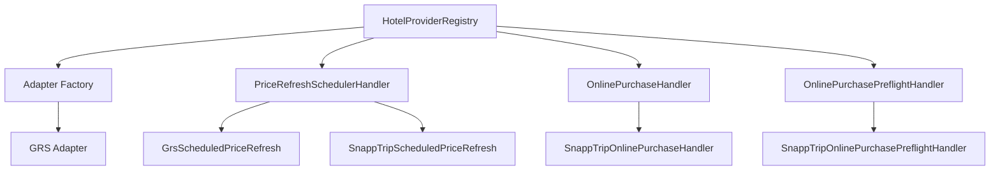

نکته مهم: generic cancellation handler هنوز به Registry اضافه نشده است. cancellation فعلی SnappTrip provider-specific است و generic reservation cancellation flow هنوز کار باقی‌مانده محسوب می‌شود.

---

# 4. جریان نرخ و ظرفیت — معماری فعلی

## 4.1 منبع زمان‌بندی

منبع due شدن Hotel:

`shared_ssp.hotel_price_refresh_schedules`

قرارداد مهم:

- `gds_id` = `accommodations.id` در Hotel GDS؛
- `hotel_accommodation_id` شناسه مستقل سمت SSP است؛
- Provider property ID از `accommodation_provider_maps` resolve می‌شود و نباید با `gds_id` اشتباه شود.

## 4.2 فلو کامل

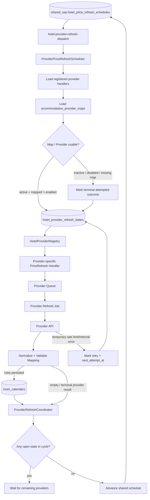

## 4.3 چرا state محلی لازم است؟

Shared SSP فقط می‌داند Hotel چه زمانی due است. اما وقتی یک Hotel همزمان در GRS و SnappTrip map شده باشد باید بدانیم:

- کدام Provider هنوز pending است؛
- کدام job queued/processing است؛
- کدام Provider retry می‌خواهد؛
- کدام Provider موفق یا terminal شده؛
- آیا cycle مشترک می‌تواند جلو برود یا نه.

این مسئولیت با `hotel_provider_refresh_states` انجام می‌شود.

## 4.4 State machine

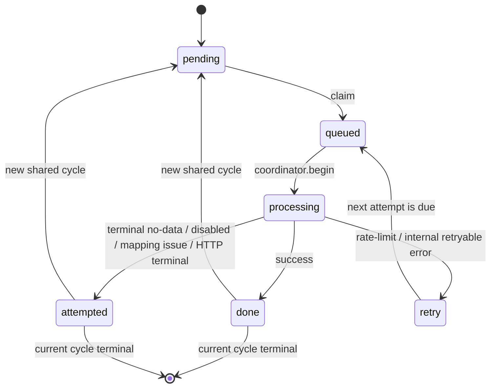

Terminal بودن به معنی «موفقیت تجاری» نیست؛ یعنی برای cycle فعلی کار بیشتری برای آن Provider وجود ندارد. برای مثال `provider_empty` می‌تواند `attempted` باشد و هنوز cycle را ببندد.

## 4.5 Outcomeهای مهم

Outcomeهایی که در Core استفاده می‌شوند شامل مواردی مثل:

- `success`
- `provider_empty`
- `provider_disabled`
- `map_disabled`
- `map_unavailable`
- `scheduler_disabled`
- `provider_404`
- `mapping_not_ready`
- `rate_limited`
- `provider_timeout`
- `provider_http_error`
- `request_error`
- `internal_error`
- `cycle_superseded`

برنامه‌نویس نباید همه outcomeها را به exception یا Telegram alert تبدیل کند.

---

# 5. GRS rate/availability flow

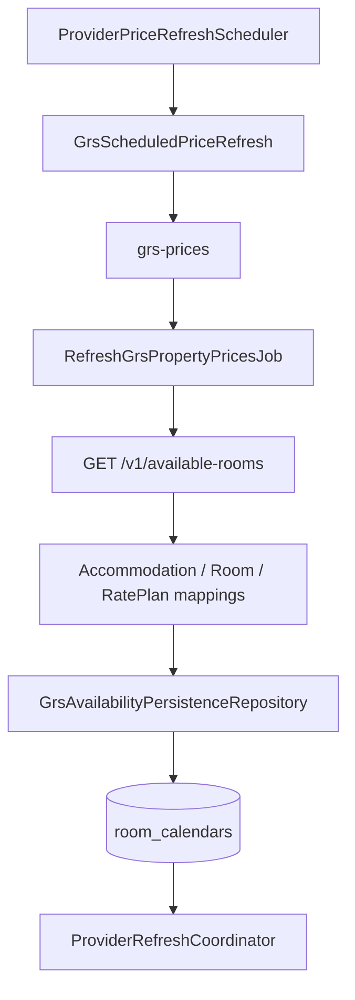

ویژگی‌های تأییدشده flow فعلی:

- map باید وجود داشته باشد و disabled نباشد؛
- quota GRS مستقل است؛
- retry و `provider_empty` state handling وجود دارد؛
- persistence روی `room_calendars` انجام می‌شود؛
- اجرای واقعی روی سرور در 2026-10-17 بررسی شد؛
- mapping واقعی Hotel/Room/RatePlan و retry واقعی بررسی شد.

آخرین snapshot عملیاتی ثبت‌شده در زمان تهیه این سند:

- `1861` GRS accommodation maps؛
- `1828` map قابل استفاده؛
- `593025` ردیف `room_calendars` برای `provider_id=1`؛
- `1735` Hotel دارای حداقل یک calendar row از GRS؛
- نمونه Hotel `1813` با Provider Property `3503` و Room/RatePlan mappings واقعی بررسی شد؛
- در نمونه retry، 19 مورد از 20 مورد دو-تلاشی به `success` رسیدند و یک مورد به `provider_empty` terminal شد.

این اعداد snapshot هستند و نباید به‌عنوان constant سیستم استفاده شوند.

---

# 6. SnappTrip rate/availability flow

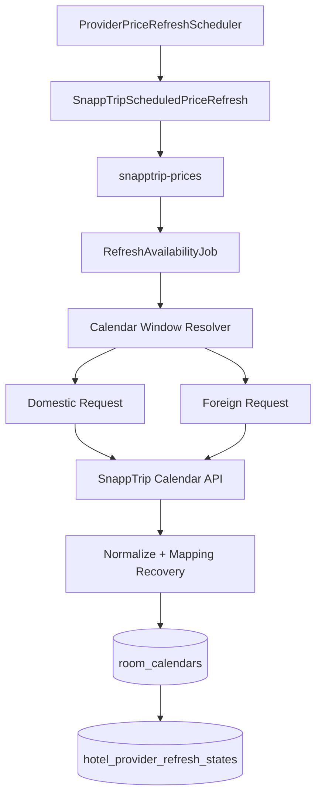

قواعد Provider-specific مهم:

- default requested horizon فعلی 90 روز است؛
- هر window برای domestic و foreign جدا درخواست می‌شود؛
- اگر Provider limit کوچک‌تری اعلام کند، flow می‌تواند window کوچک‌تر را برای Hotel یاد بگیرد؛
- 404 می‌تواند map همان Provider/Hotel را disabled کند؛
- missing room mapping یک targeted static recovery دارد؛
- `SnappTripRateLimitExceeded` به `retry` تبدیل می‌شود؛
- `provider_empty` terminal و بدون alert غیرضروری است.

بخش live verification SnappTrip هنوز باید کامل شود؛ مخصوصاً 30/40/90-day behavior و persistence واقعی روی سرور.

---

# 7. Static hotel data flow

Static data و price refresh دو مسیر مستقل‌اند. price refresh نباید منتظر catalog/details sync بماند مگر mapping مورد نیاز واقعاً موجود نباشد.

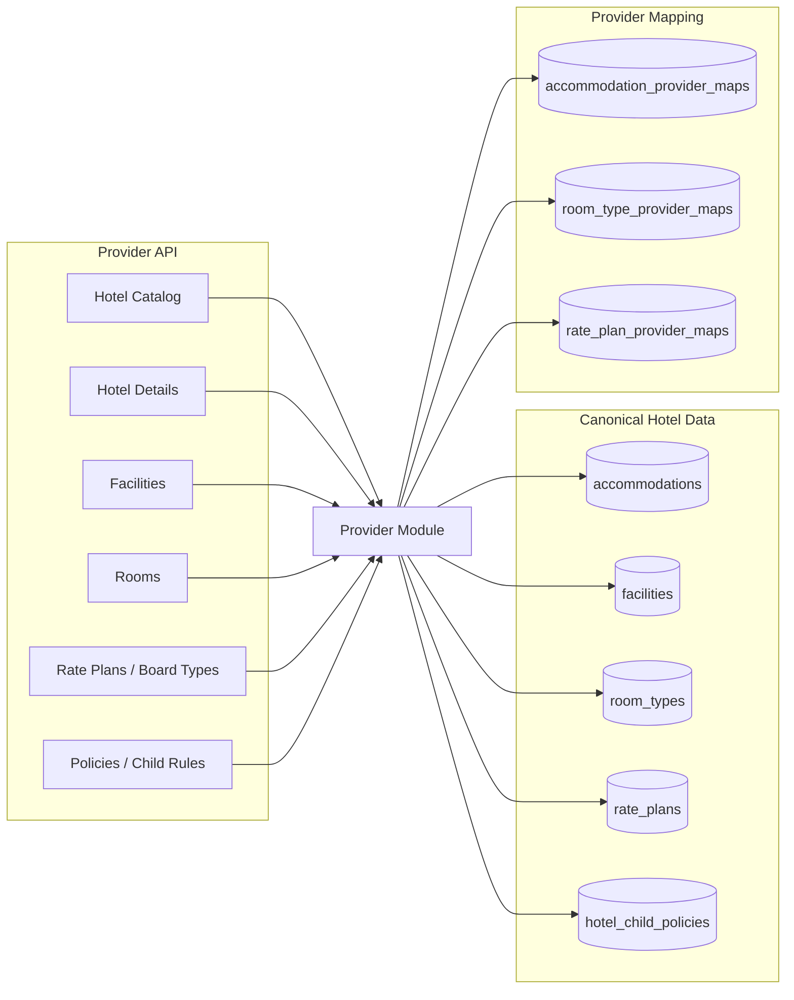

## Schedulerهای فعلی static data

### GRS

- `grs:sync-hotels` هفتگی؛
- `grs:sync-details` هفتگی؛
- queueهای `grs-hotels` و `grs-details`.

### SnappTrip

- catalog sync روزانه؛
- details command مستقل؛
- queue `snapptrip-static`.

### TODO شناخته‌شده GRS

`SyncGrsHotelCatalogJob` هنوز شرط زیر را دارد:

`!$provider->is_active || !$provider->is_online`

طبق قرارداد فعلی معماری، شرط `is_online` برای catalog درست نیست و باید در کار بعدی اصلاح و regression test شود. `is_online` باید فقط procurement mode را کنترل کند.

---

# 8. RoomCalendar و offer storage

`room_calendars` offerهای Providerها را جدا نگه می‌دارد. Providerها روی یک stay به‌صورت شب‌به‌شب با هم ترکیب نمی‌شوند.

ابعاد مهم فعلی:

- `provider_id`
- `accommodation_id`
- `room_type_id`
- `rate_plan_id`
- `provider_property_id`
- `provider_room_type_id`
- `provider_rate_plan_id`
- `day`
- `rack_rate`
- `daily_rate`
- provider-specific normalized rates مثل `grs_rate`
- `child_daily_rate`
- `infant_daily_rate`
- `inventory`
- `closed`

قاعده: data Provider باید قبل از رسیدن به این جدول به واحد پول canonical سیستم normalize شده باشد.

---

# 9. Reservation Create flow

Create باید ابتدا ticket محلی را بسازد و سپس validation خارجی را انجام دهد؛ Provider failure نباید باعث از بین رفتن ticket شود.

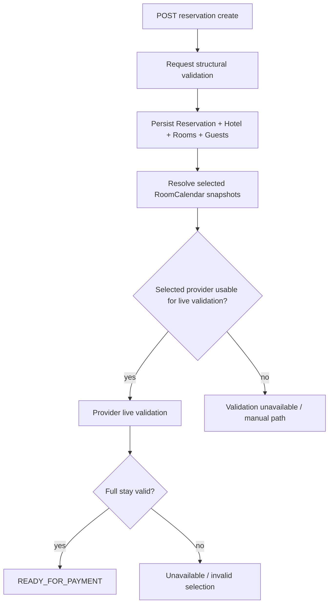

اصول مهم:

- سن مهمان باید از `birthday` محاسبه شود؛
- child policy باید بر اساس سن واقعی اعمال شود؛
- caller نباید بتواند با `age` جعلی محاسبات را تغییر دهد؛
- selected provider در create نباید خودسرانه با Provider ارزان‌تر جایگزین شود؛
- Provider inactive/offline به معنی حذف Reservation نیست.

---

# 10. Purchase flow

`ReservationPurchaseRequestService` بعد از پرداخت تصمیم می‌گیرد خرید online یا offline/manual باشد.

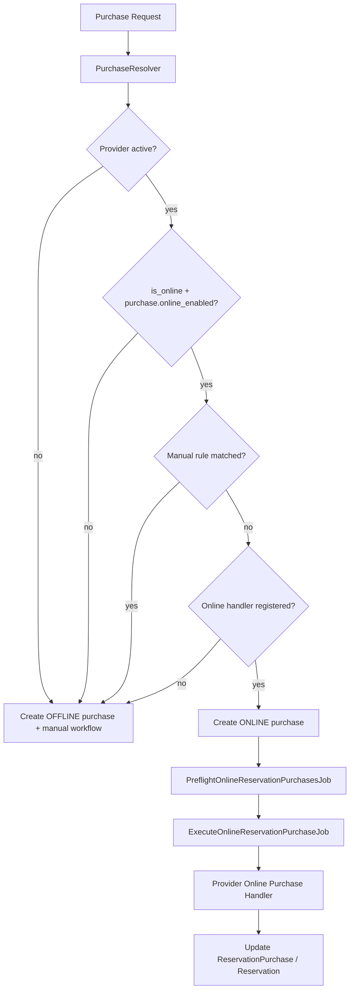

## SnappTrip online purchase

Flow پیاده‌سازی‌شده:

1. create booking؛
2. optional lock؛
3. confirm؛
4. mandatory status inquiry؛
5. retry/resume بر اساس provider booking code؛
6. price-increase safety؛
7. admin recovery برای retry یا تبدیل به manual.

Safe default فعلی `purchase.online_enabled = false` است و فعال‌سازی واقعی باید بعد از live booking verification انجام شود.

---

# 11. Cancellation — وضعیت فعلی و معماری هدف

## As-Is

SnappTrip داخل module خودش cancellation support دارد:

- create؛
- inquiry؛
- accept؛
- reject؛
- polling stateها؛
- persistence در `provider_cancellations`.

GRS Adapter نیز `cancel()` دارد، اما این‌ها هنوز به یک generic reservation cancellation orchestration وصل نشده‌اند.

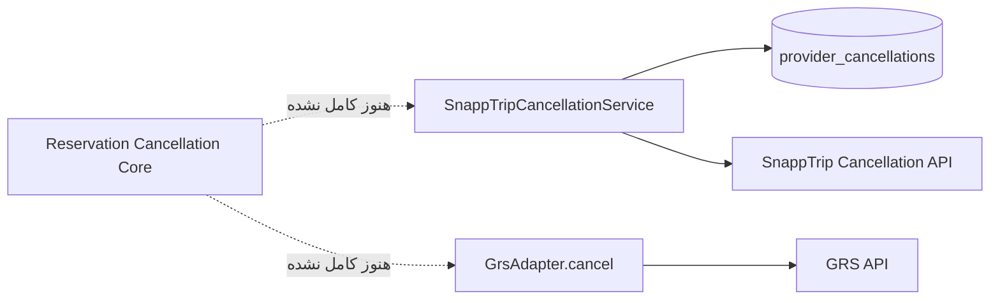

## Target

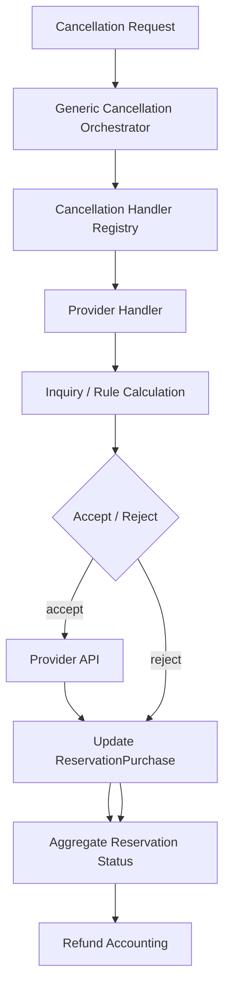

این بخش یکی از مهم‌ترین قسمت‌های باقی‌مانده پروژه است.

---

# 12. Queue و Horizon topology

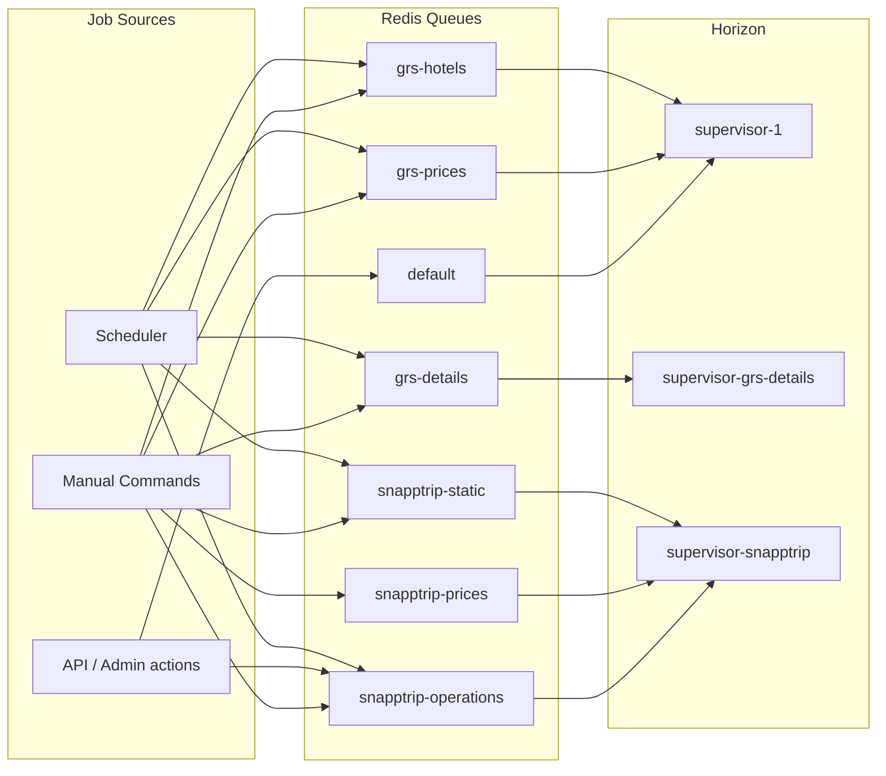

Production worker limits در config فعلی:

- `supervisor-1`: حداکثر 10 process؛
- `supervisor-grs-details`: حداکثر 10 process؛
- `supervisor-snapptrip`: حداکثر 6 process.

---

# 13. Schedulerهای مهم فعلی

| Scheduler | تناوب | مسئولیت |
|---|---:|---|
| `hotel:provider-refresh-dispatch` | هر دقیقه | generic hotel-centric rate/inventory refresh |
| `grs:sync-hotels` | هفتگی | GRS catalog |
| `grs:sync-details` | هفتگی | GRS details |
| `snapptrip-v2-static-catalog` | روزانه | SnappTrip static catalog |
| `snapptrip-v2-balance` | دو بار در روز | provider credit/balance snapshot |
| `snapptrip-v2-pending-cancellations` | هر 5 دقیقه | polling cancellationهای SnappTrip |
| `model:prune` | هر 5 دقیقه | prune `RoomCalendar` و `ProviderRequest` طبق retention model |

---

# 14. Data ownership

| داده | مالک اصلی | توضیح |
|---|---|---|
| `accommodations` | Hotel Core | Hotel canonical |
| `room_types` | Hotel Core | canonical room identity/capacity |
| `rate_plans` | Hotel Core | meal/guest semantics |
| `accommodation_provider_maps` | Integration boundary | Hotel ↔ Provider property |
| `room_type_provider_maps` | Integration boundary | Room ↔ Provider room |
| `rate_plan_provider_maps` | Integration boundary | Rate plan ↔ Provider rate plan/key |
| `room_calendars` | Hotel Core persistence | normalized per-provider offer rows |
| `hotel_price_refresh_schedules` | Shared SSP | source due schedule |
| `hotel_provider_refresh_states` | Hotel GDS | state per hotel × provider × cycle |
| `reservation_*` | Reservation Core | user ticket, rooms, guests, purchases |
| `provider_cancellations` | Provider operations | provider cancellation tracking |
| `provider_requests` | diagnostics | outbound request diagnostics with retention |

---

# 15. اضافه کردن Provider جدید

Provider جدید نباید با `if ($provider->code === ...)` در سرویس‌های عمومی پخش شود. مسیر پیشنهادی:

1. ساخت `App\Modules\HotelProviders\V2\<Provider>`؛
2. تعریف settings/support؛
3. HTTP client/gateway مستقل؛
4. static catalog/details persistence؛
5. mapping به canonical models؛
6. implement کردن `PriceRefreshSchedulerHandler`؛
7. registration در `HotelProviderRegistry`؛
8. queue مخصوص و اضافه کردن همان queue به Horizon در همان تغییر؛
9. normalize کردن currency و provider fields در module boundary؛
10. تست mapping، empty response، 404، rate limit و timeout؛
11. در صورت online procurement، implement کردن `OnlinePurchaseHandler` و در صورت نیاز `OnlinePurchasePreflightHandler`؛
12. در آینده پس از ساخت generic cancellation contract، ثبت cancellation handler؛
13. production verification با Provider API واقعی قبل از فعال‌کردن automation کامل.

---

# 16. مشاهده و عیب‌یابی عملیاتی

دستورهای مهم:

```bash
php artisan schedule:list
php artisan horizon:status
php artisan hotel:provider-refresh-status --provider=grs
php artisan hotel:provider-refresh-status --provider=snap
```

برای تست manual Provider-specific باید مراقب duplicate load بود. وقتی scheduler خودکار در حال کار است، اجرای دستی sync price بدون دلیل می‌تواند request اضافه به Provider بفرستد.

---

# 17. مواردی که باید در توسعه بعدی مراقبت شوند

- اصلاح شرط `is_online` در GRS catalog؛
- تکمیل live verification نرخ SnappTrip مخصوصاً windowهای 30/40/90 روز؛
- تکمیل generic cancellation/refund orchestration؛
- regression test برای پاسخ محلی در حالت همه Providerها inactive؛
- audit همه مسیرهای قدیمی Hotel/Provider که هنوز خارج از V2 module architecture باقی مانده‌اند؛
- monitoring بهتر برای stuck state، queue starvation، Provider latency و error rate؛
- نگهداری این سند و `HOTEL_GDS_IMPLEMENTATION_CHECKLIST.md` در هر تغییر معماری مهم.
